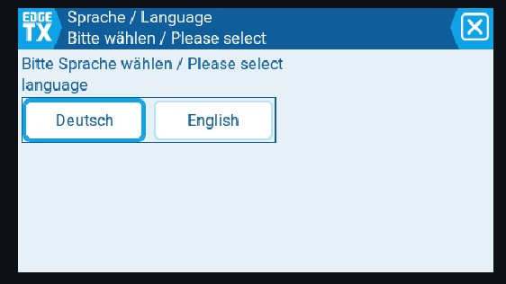
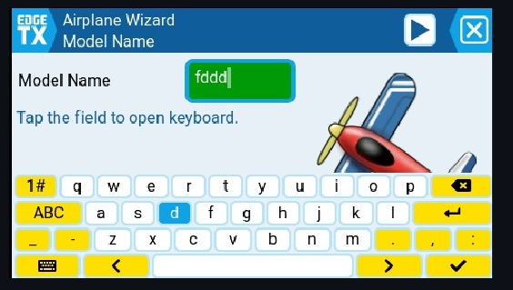
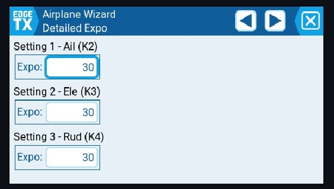

# EdgeTX Model Wizards (DE / EN)

Erweiterte Modell-Assistenten für EdgeTX 2.12+ – mit **integrierter Sprachauswahl (Deutsch/Englisch)**, Modellname und Modellbild.

* * *

## 🇩🇪 Deutsch

### Was ist das?

Dies ist eine **erweiterte und modernisierte Version** der offiziellen EdgeTX Modell-Assistenten für EdgeTX 2.12+.

Die Original-Wizards helfen beim Erstellen von neuen Modellen (Flugzeug, Segler, Delta, Helikopter, Multirotor).  
Diese Version ergänzt wichtige Funktionen und bringt ein neues, flexibles Sprachsystem mit.

### Das Highlight: Integrierte Sprachauswahl (DE / EN)

Anders als in der Original-Version, bei der die Texte fest im Code verankert sind, verfügt dieser Wizard über eine **echte Zweisprachigkeit**:

*   Beim Start des Wizards kannst du wählen, ob du ihn auf **Deutsch** oder **Englisch** bedienen möchtest.
*   Die gesamte Benutzeroberfläche (Titel, Beschriftungen, Dropdown-Menüs wie "Nein/Ja" oder "Keine/Eine/Zwei") passt sich sofort an die gewählte Sprache an.
*   Die Texte sind in separate Dateien (`lib/lang/de.lua` und `lib/lang/en.lua`) ausgelagert. Das macht das Skript übersichtlich und ermöglicht es, später ganz einfach weitere Sprachen hinzuzufügen.

### Weitere neue Funktionen gegenüber dem Original

*   ✨ **Modellname direkt im Wizard eingeben** – mit nativer Bildschirmtastatur.
*   ✨ **Modellbild direkt im Wizard auswählen** – aus dem `/IMAGES`-Ordner.
*   ✨ **Filter-Funktion für Bilder** – bei vielen Bildern schnell zum Ziel (Alle, a-c, d-f, etc.).
*   ✨ **Detaillierte Expo-Einstellungen** – separate Seite für Quer-, Höhen- und Seitenruder (ohne Zwang zu Dual Rate).
*   ✨ **Bugfixes** – einige kleinere Fehler der Original-Version behoben.

### Screenshots

| Sprachauswahl | Modellname |
| :---: | :---: |
|  |  |

| Modellbild | Detailliertes Expo |
| :---: | :---: |
|  |  |

*(Hinweis: Die Bild-Dateinamen oben müssen exakt mit den Dateien in deinem Repository übereinstimmen.)*

### Enthaltene Assistenten

Datei | Modelltyp
---|---
`1.Plane.lua` | Flugzeug
`2.Glider.lua` | Segler
`3.Wing.lua` | Delta / Nurflügler
`4.Helicopter.lua` | Helikopter
`5.Multirotor.lua` | Multirotor / Drohne

### Installation

1.  **Backup machen:** Kopiere den bestehenden Ordner `TEMPLATES/1.Wizard` von deiner SD-Karte auf den PC.
2.  **Alten Ordner löschen:** Lösche auf der SD-Karte den Ordner `TEMPLATES/1.Wizard`.
3.  **Download entpacken:** Lade die ZIP-Datei herunter und entpacke sie auf dem PC.
4.  **Neuen Ordner kopieren:** Kopiere den entpackten Ordner `1.Wizard` auf die SD-Karte nach `TEMPLATES/`.
5.  **SD-Karte in den Sender stecken.**
6.  **Modell-Manager öffnen → „Neues Modell" → Wizard auswählen.**

**⚠️ Wichtig:**
*   Dein Backup kannst du jederzeit wieder zurückkopieren.
*   Die neue Version überschreibt **nicht** deine bestehenden Modelle – nur den Wizard selbst.

### Voraussetzungen

*   EdgeTX **2.12** oder neuer
*   Sender mit SD-Karte und Lua-Unterstützung

### Lizenz

GPL v2 – siehe LICENSE

### Danksagung

Basiert auf den offiziellen EdgeTX Modell-Assistenten.  
Danke an die EdgeTX-Entwickler und alle Mitwirkenden.

### Autor

Wolfgang Dirks (DDE317)

* * *

## 🇬🇧 English

### What is this?

This is an **extended and modernized version** of the official EdgeTX Model Wizards for EdgeTX 2.12+.

The original wizards help you create new models (plane, glider, wing, helicopter, multirotor).  
This version adds important features and introduces a new, flexible language system.

### The Highlight: Integrated Language Selection (DE / EN)

Unlike the original version, where texts are hardcoded, this wizard features **true bilingual support**:

*   At the start of the wizard, you can choose to use it in **German** or **English**.
*   The entire user interface (titles, labels, dropdown options like "No/Yes" or "None/One/Two") adapts immediately to the selected language.
*   The texts are stored in separate files (`lib/lang/de.lua` and `lib/lang/en.lua`). This keeps the script clean and makes it easy to add more languages later.

### Other new features compared to the original

*   ✨ **Enter model name directly in the wizard** – with native on-screen keyboard.
*   ✨ **Select model image directly in the wizard** – from the `/IMAGES` folder.
*   ✨ **Filter function for images** – quickly find what you need (All, a-c, d-f, etc.).
*   ✨ **Detailed Expo settings** – separate page for aileron, elevator, and rudder (without mandatory dual rate).
*   ✨ **Bug fixes** – some minor bugs from the original version fixed.

### Screenshots

| Language Selection | Model Name |
| :---: | :---: |
|  |  |

| Model Image | Detailed Expo |
| :---: | :---: |
|  |  |

*(Note: The image filenames above must exactly match the files in your repository.)*

### Included Wizards

File | Model type
---|---
`1.Plane.lua` | Plane
`2.Glider.lua` | Glider
`3.Wing.lua` | Wing / Delta
`4.Helicopter.lua` | Helicopter
`5.Multirotor.lua` | Multirotor

### Installation

1.  **Make a backup:** Copy the existing `TEMPLATES/1.Wizard` folder from your SD card to your PC.
2.  **Delete old folder:** Delete the `TEMPLATES/1.Wizard` folder from your SD card.
3.  **Extract download:** Download the ZIP file and extract it on your PC.
4.  **Copy new folder:** Copy the extracted `1.Wizard` folder to your SD card under `TEMPLATES/`.
5.  **Insert SD card into your radio.**
6.  **Open Model Manager → "New Model" → select wizard.**

**⚠️ Important:**
*   Your backup can be restored at any time.
*   The new version does **not** overwrite your existing models – only the wizard itself.

### Requirements

*   EdgeTX **2.12** or newer
*   Radio with SD card support and Lua

### License

GPL v2 – see LICENSE

### Credits

Based on the official EdgeTX Model Wizards.  
Thanks to the EdgeTX developers and all contributors.

### Author

Wolfgang Dirks (DDE317)
