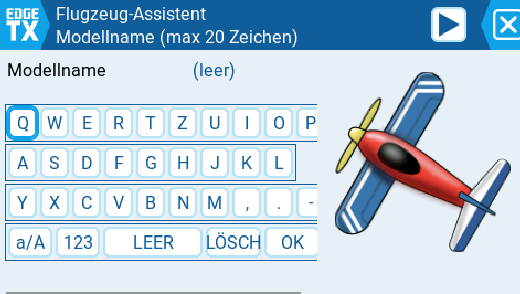
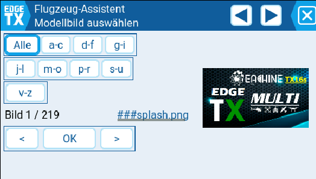

# EdgeTX Model Wizards (DE / EN)

### ⬇️ Download

| 🇩🇪 Deutsch | 🇬🇧 English |
|---|---|
| [📦 Deutsche Version herunterladen](https://github.com/DDE317/EdgeTX-Model-Wizards/raw/main/downloads/EdgeTX-Wizard-DE-v1.0.zip) | [📦 Download English version](https://github.com/DDE317/EdgeTX-Model-Wizards/raw/main/downloads/EdgeTX-Wizard-EN-v1.0.zip) |

Erweiterte Modell-Assistenten für EdgeTX 2.12+ – mit Modellname, Modellbild und deutschen Texten.

---

## 🇩🇪 Deutsch

### Was ist das?

Dies ist eine **erweiterte Version** der offiziellen EdgeTX Modell-Assistenten für EdgeTX 2.12+.

Die Original-Wizards helfen beim Erstellen von neuen Modellen (Flugzeug, Segler, Delta, Helikopter, Multirotor).  
Diese Version ergänzt zwei wichtige Funktionen, die im Original fehlen: **Modellname** und **Modellbild**.

### Was ist neu gegenüber dem Original?

- ✨ **Modellname direkt im Wizard eingeben** – mit Bildschirmtastatur (QWERTY-Layout)
- ✨ **Modellbild direkt im Wizard auswählen** – aus dem `/IMAGES`-Ordner
- ✨ **Filter-Funktion für Bilder** – bei vielen Bildern schnell zum Ziel (Alle, a-c, d-f, g-i, j-l, m-o, p-r, s-u, v-z)
- ✨ **Deutsche Übersetzung** – alle Texte auf Deutsch (zusätzlich zur englischen Version)
- ✨ **Bugfixes** – einige kleinere Fehler der Original-Version behoben

### Enthaltene Assistenten

| Datei | Modelltyp |
|---|---|
| `1.Plane.lua` | Flugzeug |
| `2.Glider.lua` | Segler |
| `3.Wing.lua` | Delta / Nurflügler |
| `4.Helicopter.lua` | Helikopter |
| `5.Multirotor.lua` | Multirotor / Drohne |

### Screenshots

**Modellname eingeben**

**Modellbild auswählen**

### Installation

1. **Backup machen:**  
   Kopiere den bestehenden Ordner `TEMPLATES/1.Wizard` von deiner SD-Karte auf den PC – z. B. als `1.Wizard_backup`.  
   (Falls du deinen Original-Wizard später wiederherstellen willst.)

2. **Alten Ordner löschen:**  
   Lösche auf der SD-Karte den Ordner `TEMPLATES/1.Wizard`.

3. **Download entpacken:**  
   Lade die ZIP-Datei herunter (siehe Download-Button oben) und entpacke sie auf dem PC.

4. **Neuen Ordner kopieren:**  
   Kopiere den entpackten Ordner `1.Wizard` (aus dem Download) auf die SD-Karte nach `TEMPLATES/`.  
   → Ergebnis: `TEMPLATES/1.Wizard` mit den erweiterten Dateien.

5. **SD-Karte in den Sender stecken.**

6. **Modell-Manager öffnen → „Neues Modell" → Wizard auswählen.**

**⚠️ Wichtig:**
- Dein Backup kannst du jederzeit wieder zurückkopieren, wenn du zum Original zurück willst.
- Die neue Version überschreibt **nicht** deine bestehenden Modelle – nur den Wizard selbst.

### Voraussetzungen

- EdgeTX **2.12** oder neuer
- Sender mit SD-Karte und Lua-Unterstützung

### Lizenz

GPL v2 – siehe [LICENSE](LICENSE)

### Danksagung

Basiert auf den offiziellen EdgeTX Modell-Assistenten.  
Danke an die EdgeTX-Entwickler und alle Mitwirkenden.

### Autor

Wolfgang Dirks ([DDE317](https://github.com/DDE317))

---

## 🇬🇧 English

### ⬇️ Download

[📦 Download English version](https://github.com/DDE317/EdgeTX-Model-Wizards/raw/main/downloads/EdgeTX-Wizard-EN-v1.0.zip)

### What is this?

This is an **extended version** of the official EdgeTX Model Wizards for EdgeTX 2.12+.

The original wizards help you create new models (plane, glider, wing, helicopter, multirotor).  
This version adds two important features that are missing in the original: **model name** and **model image**.

### What's new compared to the original?

- ✨ **Enter model name directly in the wizard** – with on-screen keyboard (QWERTY layout)
- ✨ **Select model image directly in the wizard** – from the `/IMAGES` folder
- ✨ **Filter function for images** – quickly find what you need when you have many images (All, a-c, d-f, g-i, j-l, m-o, p-r, s-u, v-z)
- ✨ **German translation** – all texts available in German (in addition to English)
- ✨ **Bug fixes** – some minor bugs from the original version fixed

### Included Wizards

| File | Model type |
|---|---|
| `1.Plane.lua` | Plane |
| `2.Glider.lua` | Glider |
| `3.Wing.lua` | Wing / Delta |
| `4.Helicopter.lua` | Helicopter |
| `5.Multirotor.lua` | Multirotor |

### Screenshots

**Enter model name**

**Select model image**

### Installation

1. **Make a backup:**  
   Copy the existing `TEMPLATES/1.Wizard` folder from your SD card to your PC – e.g. as `1.Wizard_backup`.  
   (In case you want to restore the original wizard later.)

2. **Delete old folder:**  
   Delete the `TEMPLATES/1.Wizard` folder from your SD card.

3. **Extract download:**  
   Download the ZIP file (see download button above) and extract it on your PC.

4. **Copy new folder:**  
   Copy the extracted `1.Wizard` folder (from the download) to your SD card under `TEMPLATES/`.  
   → Result: `TEMPLATES/1.Wizard` with the extended files.

5. **Insert SD card into your radio.**

6. **Open Model Manager → "New Model" → select wizard.**

**⚠️ Important:**
- Your backup can be restored at any time if you want to switch back to the original.
- The new version does **not** overwrite your existing models – only the wizard itself.

### Requirements

- EdgeTX **2.12** or newer
- Radio with SD card support and Lua

### License

GPL v2 – see [LICENSE](LICENSE)

### Credits

Based on the official EdgeTX Model Wizards.  
Thanks to the EdgeTX developers and all contributors.

### Author

Wolfgang Dirks ([DDE317](https://github.com/DDE317))
